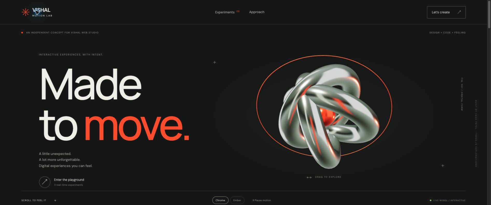

# Vishal Motion Lab

An independent interactive portfolio concept designed and developed by **Yash Patel** in response to Vishal Web Studio’s 3D & Interactive Motion Designer brief. This is not an official studio website or a commissioned client project.

**[Open the live demo](https://yashvinodbhaipatel.github.io/vishal-interactive-motion-lab/)**



## Experience

- Real-time chrome sculpture with drag, keyboard, and finish controls.
- Three interactive experiments: sculptural form, a fictional finance card, and a fictional fragrance product.
- Exploded composition, two-sided card flip, and animated bottle-cap reveal.
- Scroll-driven editorial sequence, responsive layouts, and subtle hover interactions.
- Reduced-motion support, pause control, visible focus states, keyboard tabs, and CSS fallback art.
- Live measured frame rate; rendering pauses offscreen and when the tab is hidden.

## Run locally

Requires Node.js 20 or newer. No installation or build is needed.

```sh
npm run dev
# Open http://127.0.0.1:4173
```

Alternatively serve `dist/` with any static HTTP server. `npm run check` validates the application’s JavaScript syntax.

## Stack and files

- Semantic HTML, CSS, and native JavaScript modules.
- **Three.js 0.180.0**, pinned and loaded from jsDelivr at runtime. Its core module is fetched by the module dependency. Google Fonts supplies Manrope and DM Sans with system fallbacks.
- `dist/index.html`: page content and accessible interaction markup.
- `dist/style.css`: responsive design and motion styles.
- `dist/app.js`: scene construction, controls, render lifecycle, and scroll logic.
- `scripts/serve.mjs`: dependency-free local static server.
- `.openai/hosting.json`: deployment identity and static directory for Sites.

All 3D models, environment maps, and product textures are generated in code. There are no downloaded models, HDR files, videos, or purchased assets. Three.js is MIT licensed; fonts are distributed by Google Fonts under their respective open font licenses.

## Controls

Drag either 3D stage to rotate. Focus the stage and use arrow keys to rotate; R resets the viewing angle. Use the finish swatches and the scene action button to explore each model. Experiment tabs support arrow keys, Home, and End. The global pause control stops automatic motion. OS reduced-motion preferences are respected on load and when changed.

## Performance notes

Pixel density is capped at 1.5 on desktop and 1.25 on smaller screens, with an adaptive reduction to 1 after sustained low measured frame rate. Only the most visible scene renders. Models use shared geometry/materials where appropriate; there are no real-time shadows or post-processing chains. The performance readout reports the last visible scene’s measured cadence; it is not a benchmark or guarantee.

**60 fps and sub-second loading are targets, not verified guarantees.** First-load timing includes third-party module and font requests and depends on network and hardware. Before client production, bundle or self-host dependencies, measure cold-cache loading under throttling, and profile representative mobile devices.

## Deployment

Publish the `dist/` directory to a static host. All local paths are relative, supporting a repository subpath. The Sites manifest stores the project identity. GitHub Pages is configured to publish `dist/` automatically when changes reach `main`. The live demo is hosted on GitHub Pages. A separate Sites deployment was not completed because the execution environment could not reach its Git hosting endpoint.

## Contact

Yash Patel — [GitHub](https://github.com/yashvinodbhaipatel) · [Email](mailto:pyash4329@gmail.com)

## Verification

Validated JavaScript syntax and exercised the deployed page in Brave: WebGL initialization, all experiment tabs, two-sided card flip, bottle-cap reveal, and finish switching, pause/resume, and keyboard tab navigation. No application errors were reported in the final browser console check. Desktop and 390px mobile layouts were inspected; mobile headline/scene spacing was corrected. A stable sample showed about 50 fps on the test device, so this demo does not claim the 60 fps target is verified. Cold-cache sub-second loading and low-end mobile GPU testing remain to be measured.
